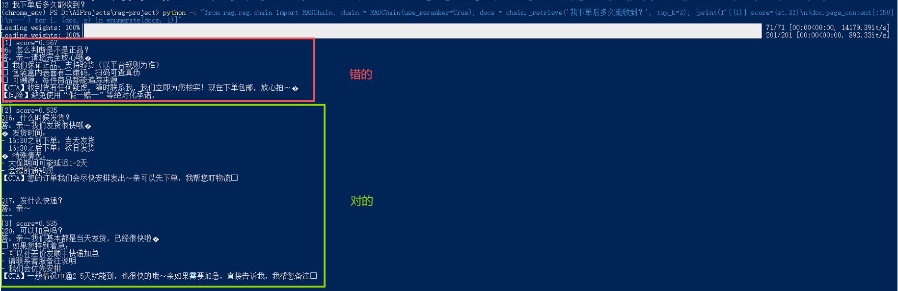
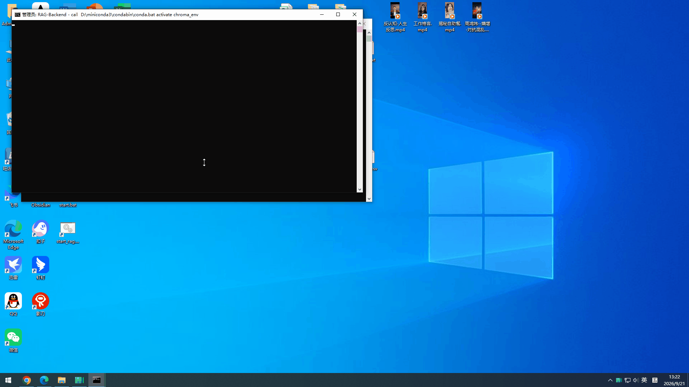
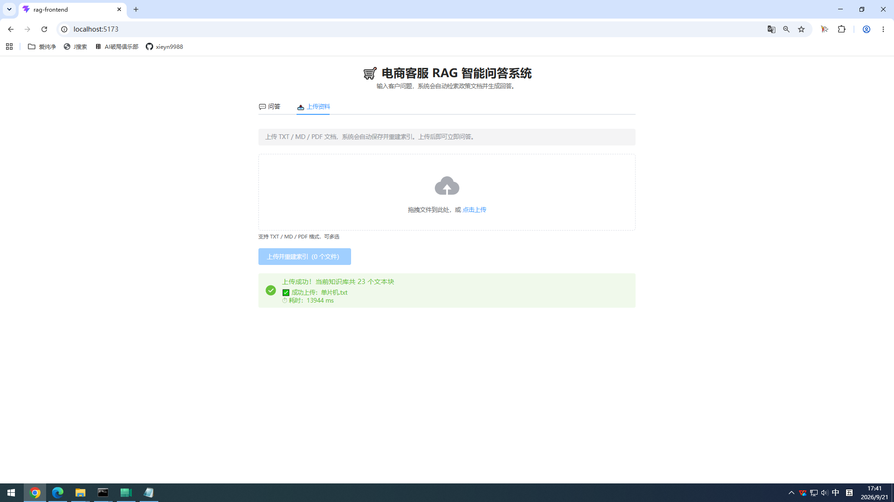
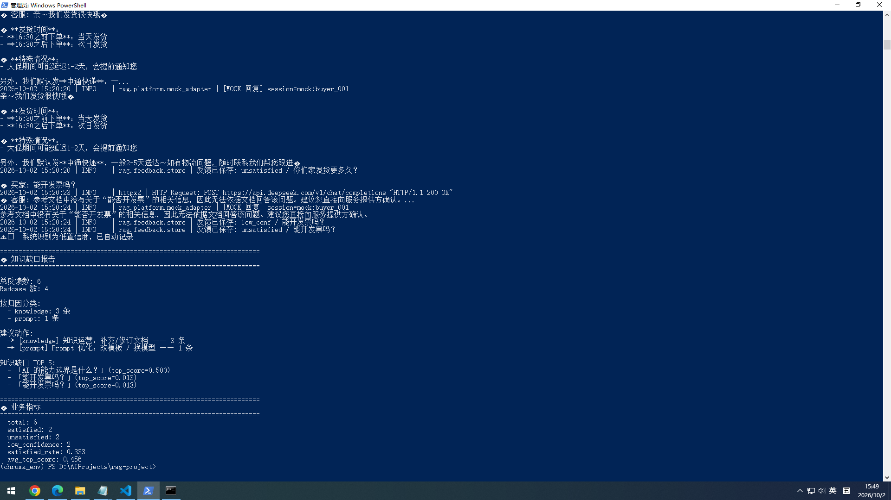
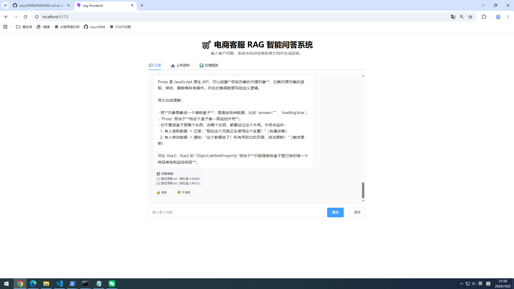
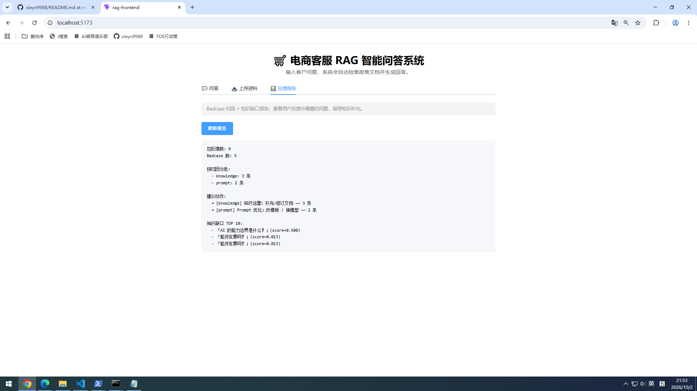

# 电商客服 RAG 智能问答系统

> 基于 **LangChain + ChromaDB + BGE + DeepSeek** 的电商客服 RAG 系统。**Vue3 全栈前端 + FastAPI + Streaming 流式输出 + 上传资料（现传现用）+ 业务闭环（反馈归因）**，Docker 一键部署。


---

## 💡 项目背景

**痛点**：电商客服每天重复回答大量问题：

- "这个商品支持 7 天无理由退货吗？"
- "快递到不了了，怎么申请补发？"
- "满减活动什么时候结束？"

**传统方案**：客服翻文档、查政策、复述给用户，平均响应 2-3 分钟。

**本项目**：把商品信息、售后政策、物流规则导入知识库，客服输入问题，系统自动检索并生成带**引用来源**的回答。

---

## 📊 项目亮点

> **性能数据**：非流式 P50 4.844s / 流式 TTFT P50 4.196s
> **检索质量**：30 条评测集，Hit@1 = 0.967
> **优化案例**：warm-up 预热 reranker，首次请求 14.77s → 3.5s

- **⚡ Streaming 流式输出**：SSE 协议逐 token 推送，用户看到打字机效果
- **📤 上传资料（现传现用）**：上传新政策 → 系统自动 ingest → 客服立即能问
- **🎯 Reranker 精排 + 引用追溯**：向量召回 + CrossEncoder 精排，附原文片段
- **🔄 业务闭环**：反馈采集 → Badcase 归因 → 知识缺口报告 → 知识迭代
- **🔌 平台适配层**：抽象 `PlatformAdapter`，支持 Webhook 接入京麦/千牛/抖店
- **🖥 全栈实现**：Vue3 + FastAPI + CLI，Docker 一键部署

---

## 📊 性能与评测

### 测试环境

| 项 | 值 |
|---|---|
| CPU | Intel i7-8700，主频 3.20GHz，6 核 12 线程 |
| 内存 | 16GB |
| GPU | NVIDIA GTX 1050 Ti，显存 4GB（**测试时未启用**，BGE 跑 CPU） |
| OS | Windows 10 |
| Python | 3.10.x |
| 测试时间 | 2026-10-14 |
| 网络 | localhost（避免公网波动） |

### 延迟（90 次实测，top_k=2）

| 接口 | P50 | P95 | P99 / Max |
|---|---|---|---|
| 非流式 `/query` | 4.844s | 5.249s | 5.463s |
| 流式 `/query/stream` TTFT | **4.196s** | 4.511s | 4.835s |
| 流式 `/query/stream` Total | 4.822s | 5.414s | 5.770s |

**测量方法**：客户端 `requests` + `time.perf_counter()`，`N_RUNS=30`，3 个问题共 90 次。报 P50/P95/P99。

### 参数调优：top_k 消融实验

| top_k | 非流式 P50 | 流式 TTFT P50 | 边际成本 |
|---|---|---|---|
| 1 | 4.532s | 3.564s | - |
| **2（默认）** | **4.844s** | **4.196s** | +0.63s |
| 3 | 5.849s | 5.483s | +1.29s |

**结论**：top_k 从 1→2 涨 0.63s，从 2→3 涨 1.29s。**边际成本在 2 之后翻倍**，所以默认选 2。

### 延迟拆解

| 阶段 | 耗时 | 说明 |
|---|---|---|
| 检索（embedding + 向量） | ~50ms | 本地 |
| Reranker（CrossEncoder） | ~200ms | 本地 |
| 组装 messages | ~1ms | 本地 |
| **DeepSeek 首 token** | **~3.3s** | **瓶颈** |

**瓶颈在 DeepSeek 首 token 延迟**，非本地代码。

### 已知优化

- ✅ **warm-up 预热 reranker**：首次请求（含模型加载） **14.77s → 3.5s**（-76%）
- ✅ **真流式实现**：`stream=True` + 逐 chunk yield，非"全生成再推"
- ✅ **`X-Accel-Buffering: no`**：防 Nginx 缓冲，保证 SSE 真流式

### 可观测性说明

DeepSeek 侧偶发排队会导致长尾波动——同一配置下，P99 在 5.5s（正常轮）到 14s（抖动轮）之间。生产环境需加超时 + 重试 + 降级模板。

### 检索准确率（30 条人工标注评测集）

**评测集**：30 条，覆盖退货/物流/活动/售后/使用/综合/边界 7 个场景。每条人工标注"答案必须出现的关键词"。

#### 知识库补全前后对比

| 阶段 | 知识库条数 | 无 Reranker Hit@1 | 有 Reranker Hit@1 |
|---|---|---|---|
| 补前 | 10 条 | 0.700 | 0.767 |
| **补后** | **23 条** | **0.933** | **0.967** |
| 提升 | - | **+23.3pp** | **+20pp** |

**关键发现**：
- **知识库补全是最大杠杆**（+20pp）——比 Reranker 贡献大 6 倍
- **Reranker 在知识库补全后仍有 +3.3pp**——不是冗余，是"排序修正"
- **Hit@3/Hit@5 = 1.0**——所有题的正确答案都能召回，只是排序不同

#### Reranker A/B 对比（知识库 23 条）

| 指标 | 无 Reranker | 有 Reranker | 提升 |
|---|---|---|---|
| Hit@1 | 0.933 | **0.967** | +3.3pp |
| Hit@3 | 1.000 | 1.000 | - |
| Hit@5 | 1.000 | 1.000 | - |
| MRR | 0.967 | **0.983** | +1.7pp |

**结论**：Reranker 提升的是 **Hit@1 和 MRR**——它把正确的 chunk 从第 2/3 名提到第 1 名。**客服场景里，Hit@1 比 Hit@5 重要**——因为 LLM 只读 top_2。

#### 评测集迭代记录

| 版本 | 条数 | Hit@1 | 迭代原因 | 关键发现 |
|---|---|---|---|---|
| v1 | 10 | 1.0 | 题太简单（关键词直接匹配） | 测不出真实水平 |
| v2 | 30 | 0.900 | 扩到 30 条，加难 case | 3 条错 case，其中 2 条是关键词未覆盖 |
| **v3** | **30** | **0.967** | **修正关键词覆盖** | **只剩 1 条真 RAG 边界** |

#### 唯一错 case 分析

**问题**：`我下单后多久能收到？`



**Reranker 后的 top 3**：

| 排名 | chunk | 相关 | 说明 |
|---|---|---|---|
| **[1]** | **"防伪" chunk** | **❌** | 含"现在下单包邮"，与"下单"字面重叠 |
| [2] | "发货时间" chunk | ✅ | 16:30 前/后，当天/次日发货 |
| [3] | "物流时效" chunk | ✅ | 中通 2-5 天 |

**根因**：Reranker 过度关注"下单"字面重叠，忽略了"多久"这个核心意图。

**这是 Reranker 的"字面偏好"** —— 它能纠正语义相似，但对"字面重叠强、语义弱"的 case 会误判。

**改进路径**：

1. **Query Rewriting**：把"多久"改写为"多长时间/发货时间" —— 让 Reranker 更容易匹配
2. **Chunk 去噪**：删掉 CTA 类内容（"现在下单包邮"）—— 减少噪声
3. **Reranker 升级**：从 base 换到 large —— 语义理解更强

### 成本

**数据来源**：25 次真实调用，从 `resp.usage` 读 token 数。

| 项 | 值 |
|---|---|
| 平均 input tokens | 596.8 |
| 平均 output tokens | 71.6 |
| **单次成本** | **¥0.00074** |
| **日均 500 次** | **¥0.37** |
| **月成本（22 天）** | **¥8.14** |

**对比人力**：
- 客服月薪 ¥6000，日均 500 问 → **单次人力成本 ¥0.55**
- AI 单次成本 ¥0.00074 → **降低 99.86%**

**说明**：
- DeepSeek 定价：¥1/百万 input tokens，¥2/百万 output tokens（2026-10）
- `input_tokens` 随检索文档长度变化（578-676），`output_tokens` 随回答长度变化（36-120）

---

### 可复现

```bash
# 延迟测试
python scripts/benchmark_latency.py
# 结果保存到 benchmarks/results/latency.json

# 检索准确率测试
python scripts/benchmark_retrieval.py
python scripts/benchmark_retrieval.py --no-reranker
# 结果保存到 benchmarks/results/retrieval_*.json

# 成本
python scripts/benchmark_cost.py
# 结果保存到 benchmarks/results/cost.json
```

---

## 🖼️ 效果演示

### 流程展示（Vue3 + Element Plus）



- 回答**逐字出现**（打字机效果）
- 附带 **📚 引用来源**（含相似度）

### 上传资料界面



**示例**：

> **提问**："我买的洗发水用了过敏，能退吗？"
>
> **回答**：可以的。根据《HFP客服知识库》，化妆品类商品如使用后出现过敏反应，可在签收后 15 天内申请退货，需提供医院过敏证明...
>
> **引用来源**：
> - [1] HFP客服知识库.txt（相似度 0.7579）
> - [2] HFP客服知识库.txt（相似度 0.4956）

### 业务闭环演示（Badcase 归因）



### 前端反馈界面




---

## ✨ 核心功能

### 🎯 RAG 问答

- **多格式文档摄入**：PDF / TXT / Markdown
- **中文语义检索**：`BAAI/bge-small-zh-v1.5` embedding + ChromaDB
- **精排重排序**：`BAAI/bge-reranker-base` CrossEncoder 精排
- **LLM 生成**：DeepSeek Chat 基于检索内容生成，避免幻觉
- **来源引用**：每个回答附带原文片段和相似度，可追溯

### 📤 上传资料（现传现用）

**核心能力**：上传文档 → 系统立即学会 → 用户就能问它。

**工作流程**：

1. 管理员上传新政策文档（TXT / MD / PDF）
2. 系统自动：切块 → embedding → 存入 ChromaDB
3. **重置 RAGChain 单例**（避免 collection 句柄失效）
4. 客服即可基于新政策问答

**电商场景价值**：

| 场景 | 传统方案 | RAG 方案 |
|------|----------|----------|
| 公司出了新政策 | 写文档 → 培训客服 → 客服背下来 | **上传文档 → 系统立即生效** |
| 客服流动 | 新员工培训 3 天才能上岗 | **第一天就能用系统辅助** |

### 🔄 业务闭环（自进化系统）

系统不是单向的"问答管道"，而是带反馈的**自进化系统**。

**闭环流程**：

```
用户提问 → RAG 回答 → 反馈采集 → Badcase 归因 → 知识更新 → 效果验证
   ↑                                                              │
   └────────────────────── 迭代循环 ──────────────────────────────┘
```

**五个环节**：

| 环节 | 实现 | 代码位置 |
|------|------|---------|
| **感知** | 显式反馈（👍/👎）+ 隐式信号（低置信度自动触发） | `src/rag/feedback/collector.py` |
| **诊断** | 规则引擎归因：知识缺失 / 检索问题 / Prompt 问题 | `src/rag/feedback/triage.py` |
| **治疗** | 自动生成知识缺口报告，指导文档补充 | `src/rag/feedback/knowledge_gap.py` |
| **度量** | 聚合指标：满意率、平均检索分、Badcase 分布 | `src/rag/feedback/metrics.py` |
| **迭代** | 知识运营 → 补充文档 → 重建索引 → 验证 | `scripts/ingest.py` |

**归因规则**：

| 检索分数 | 归因 | 建议动作 |
|---------|------|---------|
| 无检索结果 | `KNOWLEDGE` | 知识运营：补充文档 |
| top_score < 0.5 | `KNOWLEDGE` | 知识覆盖不足，补充文档 |
| 0.5 ≤ top_score < 0.7 | `RETRIEVAL` | 工程优化：调 chunk_size / top_k / Reranker |
| top_score ≥ 0.7 但用户不满意 | `PROMPT` | Prompt 优化 / 换模型 |

**演示**：

```bash
python scripts/demo_closed_loop.py
```

**输出示例**：

```
知识缺口报告
============================================================
总反馈数: 6
Badcase 数: 4

按归因分类:
  - knowledge: 3 条       → 知识运营：补充/修订文档
  - retrieval: 1 条       → 工程优化：调 chunk_size / top_k / Reranker

知识缺口 TOP 5:
  - 「你们家发货要多久？」(top_score=0.123)
  - 「能开发票吗？」(top_score=0.089)

业务指标
============================================================
satisfied_rate: 0.333
avg_top_score: 0.456
```

### 🔌 平台适配层（对接真实电商平台）

**设计目标**：不替换京麦/千牛，而是作为它们的"AI 增强外挂"，通过官方 OpenAPI 合规接入。

**架构**：

```
┌──────────────────────────────────────┐
│   电商平台（京麦 / 千牛 / 抖店）       │
└──────────────┬───────────────────────┘
               │ ① Webhook 推送买家消息
               ▼
┌──────────────────────────────────────┐
│   PlatformAdapter（抽象）             │
│   ├── MockAdapter       ✅ 已实现     │
│   ├── JingmaiAdapter    📋 待接入     │
│   └── QianniuAdapter    📋 待接入     │
└──────────────┬───────────────────────┘
               │ 统一消息模型
               ▼
┌──────────────────────────────────────┐
│   RAGChain（检索 + 重排 + 生成）       │
└──────────────┬───────────────────────┘
               │ ② 调用 sendMsg 回复
               ▼
┌──────────────────────────────────────┐
│   Feedback Loop（归因 + 知识缺口）     │
└──────────────────────────────────────┘
```

**当前状态**：

- ✅ Mock 适配器完整可用，可本地验证链路
- 📋 京麦/千牛适配器骨架就绪，拿到 ISV 资质后可快速填充
- 🔒 合规设计：签名验证、幂等去重、Webhook 5 秒响应约束

### ⚡ Streaming 流式输出

- **后端**：`StreamingResponse` 逐 token 推送
- **前端**：`fetch` + `ReadableStream` 逐块解析
- **效果**：首字立即展示

### 💬 三种使用入口

| 入口 | 状态 | 用途 |
|------|------|------|
| **Vue3 Web 界面** | ✅ 推荐 | 客服日常使用 |
| **FastAPI REST 接口** | ✅ 推荐 | 集成到现有客服系统 |
| **CLI 命令行** | ✅ 稳定 | 开发和脚本调用 |

### 🐳 工程化

- **Docker 一键部署**：`docker compose up -d`
- **一键启动脚本**：`start_rag.bat`（Windows）
- **配置外置**：`.env` + Pydantic Settings
- **日志轮转**：RotatingFileHandler
- **全链路自检**：`python scripts/check_all.py`

---

## 🏗️ 系统架构

```
┌─────────────────────────────────────────────────────┐
│         用户浏览器 (Vue3)                             │
│      💬 问答  |  📤 上传资料                          │
└─────────────────┬───────────────────────────────────┘
                  │ HTTP / SSE 流式
                  ▼
┌─────────────────────────────────────────────────────┐
│         Nginx / Vite Proxy                          │
└─────────────────┬───────────────────────────────────┘
                  ▼
┌─────────────────────────────────────────────────────┐
│         FastAPI 后端 (:8000)                        │
│  Routes → Service → RAGChain (单例)                │
│  ├── /query             非流式问答                   │
│  ├── /query/stream      流式问答（SSE）              │
│  └── /ingest/upload     上传资料 + 重建索引          │
├──────────────┬──────────────┬───────────────────────┤
│  Embedding   │  VectorStore │  LLM                  │
│  (BGE-zh)    │  (ChromaDB)  │  (DeepSeek)           │
├──────────────┴──────────────┴───────────────────────┤
│  🔄 Feedback Loop  (反馈采集 → 归因 → 知识缺口)      │
├─────────────────────────────────────────────────────┤
│  🔌 Platform Adapter  (Mock / 京麦 / 千牛)          │
└─────────────────────────────────────────────────────┘
```

---

## 🛠️ 技术栈

| 组件 | 技术 |
|------|------|
| **前端** | Vue3 + Element Plus + Axios |
| **后端** | FastAPI + Uvicorn |
| **RAG 框架** | LangChain |
| **向量数据库** | ChromaDB |
| **Embedding** | BAAI/bge-small-zh-v1.5 |
| **Reranker** | BAAI/bge-reranker-base |
| **LLM** | DeepSeek Chat |
| **流式协议** | SSE（Server-Sent Events） |
| **配置** | Pydantic Settings |
| **部署** | Docker + Compose |

---

## 🚀 快速开始

### 前置条件

- Python 3.10+
- Node.js 18+
- （可选）Docker Desktop

### 方式一：一键启动脚本（Windows）

双击 `start_rag.bat`，自动：
1. 启动 FastAPI 后端（:8000）
2. 启动 Vue3 前端（:5173）
3. 轮询 `/health` 等后端就绪
4. 自动打开浏览器

### 方式二：手动启动

```bash
# 1. 克隆
git clone https://github.com/xieyn9988/rag-project.git
cd rag-project

# 2. 虚拟环境
conda create -n chroma_env python=3.10 -y
conda activate chroma_env

# 3. 依赖
pip install -e ".[dev]"

# 4. 配置
cp .env.example .env
# 编辑 .env，填入 DeepSeek API Key

# 5. 摄入数据
python scripts/ingest.py --rebuild

# 6. 后端（CMD 1）
python apps/fastapi_app.py

# 7. 前端（CMD 2）
cd rag-frontend && npm install && npm run dev

# 8. 浏览器
# http://localhost:5173
```

### 方式三：Docker 一键部署

```bash
cp .env.example .env
docker compose up -d

# 前端：http://localhost
# API 文档：http://localhost:8000/docs
```

**注意**：
- **首次 build**：约 10-15 分钟（装 torch + 依赖）
- **首次启动**：容器会 warm-up（加载 BGE + Reranker），约 10-15 秒
- **健康检查**：`curl http://localhost:8000/health` —— 返回 `{"status": "ok", "doc_count": 23}`
- **数据持久化**：`storage/chroma_db` 挂载到宿主机，容器重启不丢索引
- **服务名**：`rag-api`（不是 `api`）

---

## 📖 使用说明

### 客服日常使用（Vue3 界面）

浏览器 `http://localhost:5173`：

- **💬 问答 Tab**：输入问题，回答逐字出现，附带引用来源
- **📤 上传资料 Tab**：拖拽 TXT/MD/PDF，点击上传，系统自动重建索引

### 集成到现有客服系统（API）

> 以下 `curl` 示例不传 `top_k`，用服务端默认值（`config.py` 的 `top_k=2`）。

**非流式接口**：

```bash
curl -X POST http://localhost:8000/query \
  -H "Content-Type: application/json" \
  -d '{"question": "洗发水过敏能退吗？"}'
```

**响应**：

```json
{
  "msg_id": "335b4b55-...",
  "question": "洗发水过敏能退吗？",
  "answer": "可以的。根据《HFP客服知识库》...",
  "retrieved": [
    {
      "content": "...",
      "source": "HFP客服知识库.txt",
      "page": null,
      "score": 0.7579
    }
  ]
}
```

**流式接口（SSE）**：

```bash
curl -X POST http://localhost:8000/query/stream \
  -H "Content-Type: application/json" \
  -d '{"question": "退货"}'
```

**响应流**：

```
data: {"type": "start", "msg_id": "0e2f45b6-...", "session_id": "session:0e2f45b6"}
data: {"type": "content", "text": "亲"}
data: {"type": "content", "text": "~"}
data: {"type": "content", "text": "关于"}
...
data: {"type": "references", "references": [{"source": "HFP客服知识库.txt", "page": null, "score": 0.7579}]}
data: {"type": "done", "elapsed_ms": 2060}
data: [DONE]
```

**上传资料接口**：

```bash
curl -X POST http://localhost:8000/ingest/upload \
  -F "files=@data/text/新政策.md"
```

---

## ⚙️ 配置

> **默认值以 `src/rag/config.py` 为准。** 下表只列"可配置项"和"作用"，具体默认值请查阅代码。

| 变量 | 说明 | 建议 |
|------|------|------|
| `RAG_LLM_API_KEY` | **必填**，DeepSeek API Key | 从 [DeepSeek 平台](https://platform.deepseek.com/) 获取 |
| `RAG_LLM_BASE_URL` | DeepSeek API 地址 | 默认官方地址，一般不改 |
| `RAG_LLM_MODEL` | 模型名 | 默认 `deepseek-chat` |
| `RAG_EMBED_MODEL` | Embedding 模型 | 默认 `BAAI/bge-small-zh-v1.5` |
| `RAG_CHUNK_SIZE` | 文本块大小 | 默认 500，改小召回更细，改大上下文更完整 |
| `RAG_CHUNK_OVERLAP` | 块间重叠 | 默认 50，防止语义被切断 |
| `RAG_TOP_K` | 检索文档数 | 默认 2，改大准确率↑但延迟↑ |
| `HF_ENDPOINT` | HuggingFace 镜像 | 国内网络建议 `https://hf-mirror.com` |

**覆盖方式**：在 `.env` 里写 `RAG_XXX=值`，会覆盖 `config.py` 的默认值。

**查看当前生效值**：

```bash
curl http://localhost:8000/health
# 返回 model_llm / model_embed / doc_count 等关键配置
```

---

## 📝 设计要点

1. **分层架构**：`interface / service / chain / infra` 四层分离
2. **抽象接口**：`Embedder / VectorStore / LLM` 三个 ABC，换供应商不改业务代码
3. **Reranker 精排**：`top_k × 3` 召回 → CrossEncoder 精排 → `top_k`
4. **单例管理**：`RAGChain` 全局复用，避免每次请求重载 BGE 模型
5. **上传后重置单例**：ingest 后 collection 句柄失效，必须重置 RAGChain
6. **反馈闭环**：RAG 质量 70% 取决于知识质量，闭环让"用户不满意"变成"知识补充"输入
7. **归因规则**：200 行规则，准确性高于 AI、成本为零、可解释
8. **平台适配层**：抽象 `PlatformAdapter`，业务代码不耦合平台 API
9. **国内网络优化**：`HF_ENDPOINT=hf-mirror.com` 避免模型下载超时

---

## 🎯 技术边界

**不是所有 PDF 都能解析**：

- ✅ 结构化单页 PDF
- ✅ 电子档 PDF（可选中文字）
- ⚠️ 扫描件 PDF → 需 OCR，暂不支持
- ⚠️ 多页切分式宽表 PDF → 暂不支持

**建议**：PDF 请先另存为 Excel/CSV/TXT 后上传。

**平台对接边界**：

- ✅ Mock 适配器本地完整可用
- ⚠️ 京麦/千牛真实接入需要 ISV 资质
- 📋 适配器骨架已就位，拿到资质后可快速填充

### 真实案例：系统遇到"元问题"时的行为

**场景**：用户在对话中看到 AI 回复了一句"我们理解您的心情，服务态度很好的"，接着问：

> 用户："我们理解您的心情，服务态度很好的 --- 这是什么回答"

**系统的回答**：

> 参考文档中没有关于"我们理解您的心情，服务态度很好的"这句话的具体说明或评价，因此无法基于文档判断它属于哪种回答类型或是否合适。
>
> 不过，结合文档 1 中"AI 客服话术需人工复核"的原则，可以明确一点：
>
> - 这类话术属于 **情绪安抚型 / 服务态度表达**，本身不涉及事实、数据或专业建议，通常...

**为什么这个回答是"正确"的**：

| 判断标准 | 系统行为 | 结果 |
|---------|---------|------|
| 是否基于检索内容 | 引用 `HFP客服知识库.txt`（相似度 0.6820） | ✅ 有据可依 |
| 是否产生幻觉 | 没有编造"这句话是我们的话术" | ✅ 忠实文档 |
| 是否承认局限 | "文档中没有关于这句话的具体说明" | ✅ 诚实 |
| 是否可追溯 | 附引用来源和相似度 | ✅ 可 debug |

**这个案例暴露了 RAG 系统的两个本质**：

1. **系统只处理字面问题，不处理真实意图**——用户真实意图可能是"吐槽这句话很假"，但系统把它当"元问题"来回答。**这不是 bug，是 RAG 的边界**。
2. **"答得不准" 不等于 "答错"**——系统**严格遵守"基于文档回答"的约束**，宁可不答、不猜，也不编造。

**未来改进方向**：

- **短期**：Prompt 加"意图识别"约束，遇到元问题先澄清用户真实意图
- **中期**：加意图分类前置层（factual / meta / complaint / chitchat），不同意图走不同 Prompt
- **长期**：加多轮对话记忆，让 LLM 看到"上一轮自己说了什么"，从而理解"这"指的是什么

---

## 🔮 未来规划

- [ ] **真实平台接入**：填实京麦/千牛适配器
- [ ] **多轮对话记忆**：基于 LLM 的历史压缩
- [ ] **多租户隔离**：不同企业独立知识库
- [ ] **Query Rewriting**：把口语化 query 改写为"检索友好"的形式
- [ ] **Chunk 去噪**：去掉 CTA（Call To Action）类噪声
- [ ] **Voice RAG**：集成 Whisper
- [ ] **可观测性**：Prometheus + Grafana
- [ ] **灰度 A/B**：优化方案灰度发布

---

## 📄 License

MIT

## 🙏 致谢

- [LangChain](https://github.com/langchain-ai/langchain)
- [ChromaDB](https://github.com/chroma-core/chroma)
- [BAAI BGE](https://github.com/FlagOpen/FlagEmbedding)
- [DeepSeek](https://www.deepseek.com/)