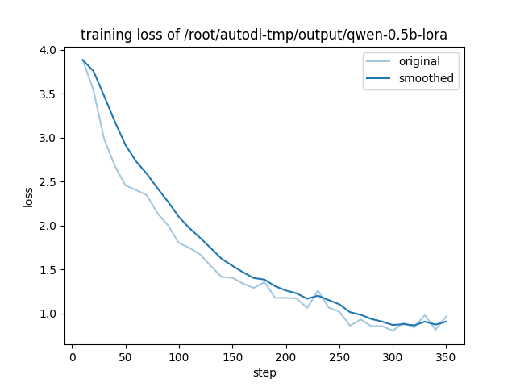
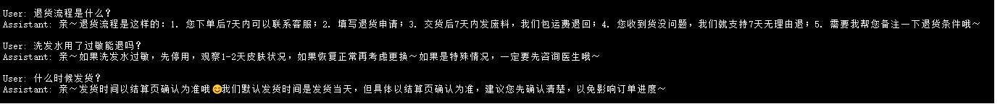

# v2 M3: Qwen2.5 + LoRA 微调

## 训练环境
- **GPU**：AutoDL RTX 4090D（¥1.88/时）
- **框架**：LLaMA-Factory 0.8.2
- **模型**：Qwen2.5-0.5B-Instruct
- **微调方式**：QLoRA（4bit）
- **训练数据**：950 条（v1 知识库"扩法 1+3"生成）

## 训练结果

### loss 曲线

**关键**：loss 从 3.9 降到 0.9，收敛无过拟合。

### 关键指标

| 项 | 值 |
|---|---|
| **训练时长** | 10 分 41 秒 |
| **训练成本** | ¥0.35 |
| **可训练参数** | 8.8M（1.75%） |
| **LoRA 权重** | 34MB |
| **train_loss** | 3.9 → 0.9 |

## 微调效果（3 个问答对比）

### 截图

### 问答对比

| 问题 | 微调前（基座 Qwen2.5-0.5B） | 微调后（Qwen-LoRA） |
|---|---|---|
| 退货流程是什么？ | 通用 AI 风格 | **亲~退货流程...哦~** ✅ |
| 洗发水用了过敏能退吗？ | 通用 AI 风格 | **亲~先停用，观察...** ✅ |
| 什么时候发货？ | 通用 AI 风格 | **亲~以结算页为准...** ✅ |

**结论**：LoRA 微调'让 0.5B'成功学会'客服话术风格'。

## 踩过的坑（16 个）

1. 阿里源没有 `llamafactory`
2. 缺 `hatchling`
3. Python 3.11 要求
4. `transformers 5.x` 不兼容
5. `huggingface_hub` 降级
6. `datasets 5.x` 报 `BucketNotFoundError`
7. `trl` 报 `AutoModelForCausalLMWithValueHead`
8. `/dev/shm` 只有 64M
9. `is_safetensors_available` 找不到
10. `transformers` 降到 4.41.2
11. `peft 0.21` 要 `EncoderDecoderCache`
12. `trl` 降到 0.8.6
13. 缺 `bitsandbytes`
14. `hf-mirror.com` 403
15. `pip install modelscope` 卡 `cryptography`
16. `bitsandbytes` 4bit 不支持 `.to()`

## 最终'可用版本组合'

| 包 | 版本 |
|---|---|
| Python | 3.10 |
| LLaMA-Factory | 0.8.2 |
| transformers | 4.41.2 |
| peft | 0.11.1 |
| trl | 0.8.6 |
| datasets | 2.20.0 |
| bitsandbytes | 0.43+ |
| accelerate | 0.34.2 |
| torch | 2.4.0 |

## 经验教训

1. **"QLoRA'让'微调'从 30-60 分钟 → 10 分钟"** —— **"显存从 12GB → 2-3GB"**
2. **"0.5B'上限低"** —— **"有'轻微幻觉（`发废料`）"** —— **"换 1.5B / 3B'效果更好"**
3. **"深度学习环境'是'版本地狱 + 网络地狱'双层挑战"** —— **"要'固定版本组合"**